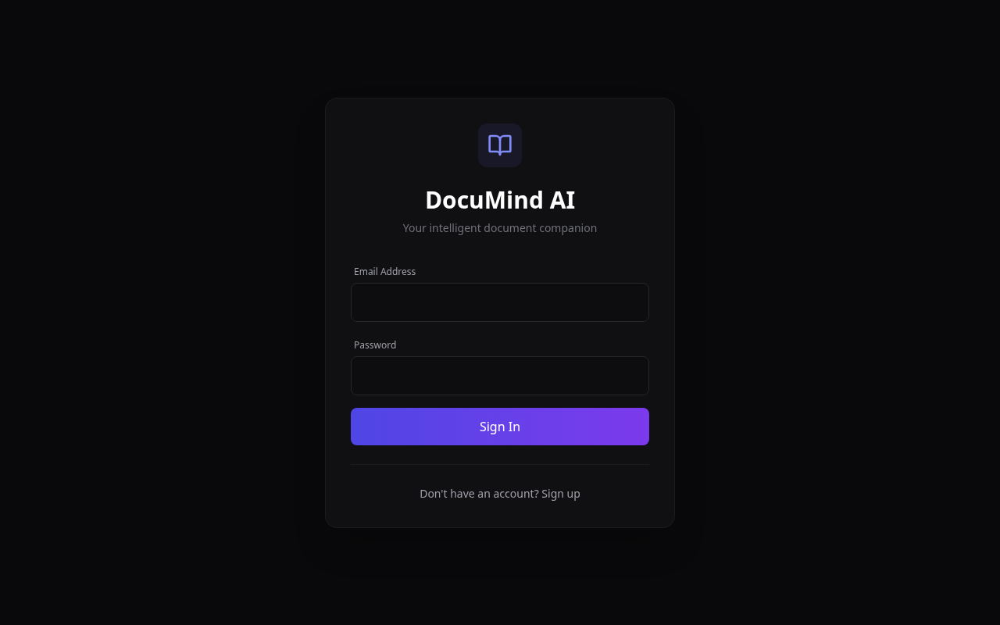

# DocuMind AI

Upload PDF manuals to a personal library, browse documents other users have shared, and ask questions about any document. Answers come from IBM watsonx (Granite 3 8B Instruct), using the document's own text as context.

**Live demo:** https://ibm-ai-manual-summarizer-and-upload.vercel.app



## Features

- Email/password sign-in with Firebase Authentication
- PDF upload: the backend extracts and cleans the text with `pypdf` and stores it page by page in Firestore
- Personal library with search by title, content or tags
- Community view of documents shared by other users
- Chat with a document: questions are answered by `ibm/granite-3-8b-instruct` on watsonx.ai

## Tech stack

| Part | Stack |
|---|---|
| Frontend (`frontend/`) | React 18, TypeScript, Vite, Tailwind CSS, Firebase JS SDK, lucide-react |
| Backend (`backend/`) | Django, Django REST Framework, firebase-admin, ibm-watsonx-ai, pypdf |
| Data and auth | Firebase Authentication, Cloud Firestore |
| Hosting | Vercel (frontend), Render (backend) |

## API

Routes live under `/api/`. Upload, library and document content require a Firebase ID token.

| Endpoint | Purpose |
|---|---|
| `POST /api/upload/` | Upload a PDF and store its pages |
| `GET /api/library/` | List the signed-in user's documents |
| `POST /api/doc-content/` | Fetch a document's text |
| `POST /api/chat/` | Ask watsonx a question about a document |

## Running locally

1. Create `backend/.env` with your watsonx credentials:

   ```
   WATSONX_APIKEY=...
   PROJECT_ID=...
   ```

2. Save a Firebase service-account key as `backend/config/serviceAccountKey.json`.
3. Start both services:

   ```bash
   docker compose up
   ```

   The frontend runs on http://localhost:5173 and the backend on http://localhost:8000. Set `VITE_API_URL` if the backend runs elsewhere.
